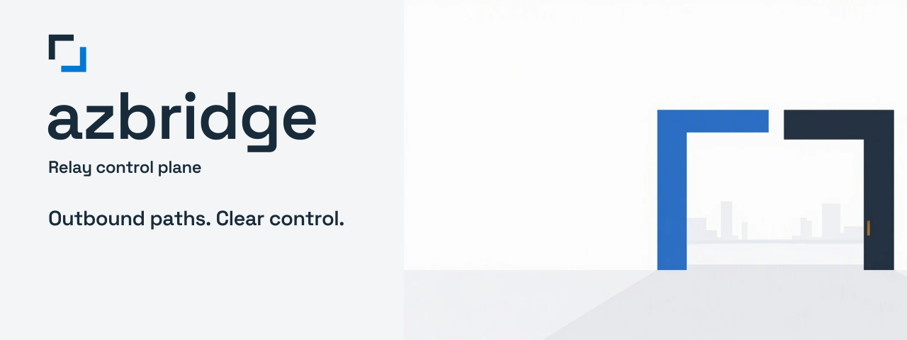

# azure-relay-bridge-rs (azbridge)

<picture>
  <source media="(prefers-color-scheme: dark)" srcset="docs/brand/assets/readme-banner-dark.svg">
  
</picture>

**Outbound paths. Clear control.**

A Rust implementation of [Azure Relay Bridge](https://github.com/Azure/azure-relay-bridge) — a CLI tool that creates VPN-less TCP, UDP, HTTP, and Unix socket tunnels between any pair of hosts using [Azure Relay Hybrid Connections](https://learn.microsoft.com/en-us/azure/azure-relay/relay-hybrid-connections-protocol).

Traffic flows over outbound HTTPS (port 443) only — no inbound firewall rules or VPNs required.

See the [brand guidelines and artwork provenance](docs/brand/README.md).
The CLI shows its banner on interactive foreground stderr only; suppress it with
`-q` or `AZBRIDGE_NO_BANNER=1`. Non-TTY, service, TUI and managed subcommand output
remain banner-free.

## Quick Start

```sh
# Local forward: expose remote-host:3306 on local port 3306 via Azure Relay
azbridge -L 3306:my-relay -x "Endpoint=sb://mynamespace.servicebus.windows.net;..."

# Remote forward: accept relay connections and forward to localhost:8080
azbridge -T my-relay:8080 -x "Endpoint=sb://mynamespace.servicebus.windows.net;..."
```

### Managed mode (workspace broker)

For centrally managed gateways, an operator first creates a workspace, Relay
connection and published profile in the broker's browser UI. Then enroll a
gateway using its assigned workspace/profile names (or UUIDs):

```sh
azbridge login --broker https://broker.example.com --workspace my-workspace --profile my-profile --name my-gateway
azbridge status
azbridge
azbridge logout
```

`login` displays GitHub's device verification URL and code; approve only a flow
you initiated for a trusted broker. It saves a broker-issued gateway credential,
not a GitHub access token or Azure namespace key. `status` checks broker
connectivity and the **assigned** revision, not a running process's applied
revision. `logout` revokes the credential before removing saved enrollment.
Add `--machine` to these three subcommands for machine state; Windows services
use machine state only.

While enrolled, plain `azbridge` fetches the published configuration at startup.
There is no offline cache, background profile refresh or live configuration
reload: restart to apply a newly published revision. Local YAML, credential and
forwarding flags, `-f`, all `-o` overrides, network flags and `--tui` cannot
override a managed profile; conflicting flags fail. Only local logging flags
(`-q`, `-v`, `-l`) are allowed. Foreground enrollment selection is environment,
then user, then machine state. Containers may supply both
`AZBRIDGE_BROKER_URL` and `AZBRIDGE_GATEWAY_CREDENTIAL` instead of a state file.
With no managed state, the original local-mode behavior is unchanged.

To migrate existing standalone YAML, use **Import configs** on the workspace's
Profiles tab, or **Import standalone config** in a profile editor. Credentials
are stripped in the browser; saved revisions are never automatically published.
See the [migration/import guide](web/README.md#import-standalone-configurations).

See [managed gateway setup and credential protection](docs/managed-gateway.md),
the [broker operator guide](crates/azbridge-broker/README.md), and
[Azure deployment preparation](docs/broker-deployment.md). Deployment commands
there are operator instructions, not evidence that a service has been deployed.
Revocation blocks future broker calls but does **not** kill established tunnels;
already issued SAS tokens may remain usable until expiry.

## Supported Tunnel Types

| Mode | Flag | Example |
|------|------|---------|
| **TCP local forward** | `-L` | `-L 3306:my-relay` |
| **TCP remote forward** | `-T` | `-T my-relay:3306` |
| **UDP** | `-L` / `-T` | `-L 5000U:my-relay` (suffix `U`) |
| **HTTP reverse proxy** | `-H` | `-H my-relay:http/localhost:8080` |
| **Unix socket** | `-L` / `-T` | `-L /tmp/sock:my-relay` (Linux/macOS) |

## Installation

### Build from source

Requires [Rust 1.85+](https://rustup.rs/) (edition 2024).

```sh
cargo build --release
# Binary at target/release/azbridge
```

### Docker

```sh
docker build -t azbridge .
docker run azbridge -L 8080:my-relay -x "Endpoint=sb://..."
```

## CLI Usage

```
azbridge [OPTIONS]

Options:
  -L <spec>       Local forward: [bind_address:]port[/port_name]:relay_name
  -T <spec>       Remote forward: relay_name:[port_name/][host:]port
  -H <spec>       HTTP forward: relay_name:{http|https}/[host][/path]:port
  -e <endpoint>   Azure Relay endpoint (sb://namespace.servicebus.windows.net)
  -x <string>     Azure Relay connection string
  -K <name>       Shared Access Key name
  -k <key>        Shared Access Key
  -s <sig>        Shared Access Signature token
  -f <file>       Config file path
  -o <key:value>  Override config option
  -g              Gateway ports (bind to 0.0.0.0 instead of 127.0.0.1)
  -b <address>    Bind address for outbound connections
  -v              Increase verbosity (repeat for more: -vv, -vvv)
  -q              Quiet mode (errors only)
  -l <file>       Log to file
  -a <seconds>    Keep-alive interval
  -I              Install as Windows service
  -U              Uninstall Windows service
  --tui           Interactive configuration UI (local mode only)
```

Managed subcommands: `login --broker <origin> --workspace <name-or-id>
--profile <name-or-id> [--name <gateway>] [--machine]`, `status [--machine]`,
and `logout [--machine]`. Run `azbridge <subcommand> --help` for full syntax.

## Configuration

In **local mode**, azbridge loads configuration from YAML files in this order
(later overrides earlier):

1. **Machine config**: `/etc/azbridge/azbridge_config.machine.yml` (Linux) or `%PROGRAMDATA%\Microsoft\AzureBridge\azbridge_config.machine.yml` (Windows)
2. **User config**: `~/.azbridge/azbridge_config.yml` (Unix) or `%APPDATA%\azbridge\azbridge_config.yml` (Windows; home-directory fallback if `APPDATA` is absent)
3. **`-f` file** (overrides user config)
4. **`-o` overrides** (inline YAML key:value)
5. **CLI flags** (highest priority)

### Config file format

```yaml
AzureRelayConnectionString: "Endpoint=sb://mynamespace.servicebus.windows.net;SharedAccessKeyName=...;SharedAccessKey=..."

LocalForward:
  - RelayName: my-database-relay
    Bindings:
      - BindPort: 3306
        PortName: mysql

RemoteForward:
  - RelayName: my-web-relay
    Bindings:
      - Host: localhost
        HostPort: 8080
        PortName: http

# Optional settings
ExitOnForwardFailure: true   # Stop if any bridge fails to start (default: true)
ConnectionAttempts: 1        # Retry count for listener connections (1-10)
ConnectTimeout: 60           # Timeout in seconds for connections (0-120)
AddressFamily: any           # any, inet (IPv4 only), inet6 (IPv6 only)
GatewayPorts: false          # Bind to 0.0.0.0 instead of 127.0.0.1
```

## Authentication

### Shared Access Signature (SAS)

Provide credentials via connection string, CLI flags, or config file:

```sh
# Connection string (contains key name + key)
azbridge -L 3306:relay -x "Endpoint=sb://ns.servicebus.windows.net;SharedAccessKeyName=send;SharedAccessKey=base64key=="

# Separate flags
azbridge -L 3306:relay -e sb://ns.servicebus.windows.net -K send -k base64key==
```

### Azure Active Directory (Entra ID)

When no SAS credentials are provided, azbridge automatically uses `az login` credentials via the Azure Identity SDK:

```sh
az login
azbridge -L 3306:relay -e sb://ns.servicebus.windows.net
```

## Architecture

```
┌──────────────────────────────────────────────────┐
│                   azbridge CLI                    │
│  config · cli · host · logging · service          │
├──────────────────────────────────────────────────┤
│        TCP · UDP · HTTP · Unix Socket             │
│   local forward bridges · remote forwarders       │
│         stream pump · preamble protocol           │
├──────────────────────────────────────────────────┤
│              azure-relay crate                    │
│  client · listener · stream · protocol · auth     │
│    WebSocket · SAS tokens · AAD · connection str  │
└──────────────────────────────────────────────────┘
            │                        ▲
            │ outbound HTTPS/443     │
            ▼                        │
    ┌───────────────────────────────────┐
    │      Azure Relay Service          │
    │    Hybrid Connections endpoint    │
    └───────────────────────────────────┘
```

## Development

```sh
cargo build              # Debug build
cargo test --workspace   # Run offline tests; live tests are ignored
cargo clippy --workspace # Lint
cargo fmt --check        # Format check
```

### Running live integration tests

The ignored Relay tests require a live Azure Relay namespace:

```sh
# Set connection string and run ignored tests
$env:RELAY_CONNECTION_STRING = "Endpoint=sb://...;SharedAccessKeyName=...;SharedAccessKey=..."
cargo test -p azure-relay --ignored
```

Prerequisites: create two Hybrid Connections named `authenticated` and `unauthenticated` in the namespace.

### Broker and web checks

```powershell
cargo run -p azbridge-broker-api --example generate_types
git diff --exit-code -- web/src/api/generated/index.ts
npm --prefix web ci
npm --prefix web run lint
# package.json has no typecheck script; invoke the installed compiler directly.
Push-Location web
npm exec -- tsc --noEmit
npm test
npm run build
Pop-Location
python infra\tests\test_contract.py
```

Commit generated `web/src/api/generated/index.ts` changes together with Rust DTO
changes. CI checks drift, runs the SPA lint/typecheck/Vitest/build, compiles both
Bicep entry points and runs offline infrastructure contracts, and builds
`Dockerfile.broker` without pushing an image. These checks do not authenticate
to GitHub/Azure or prove live provisioning, OAuth, or tunnel interoperability.
The broker image needs a working Linux Docker engine; an independent Rust/SPA
build is not a verified Docker build. See [the web guide](web/README.md) for
the local Vite proxy and development sign-in.

## Compatibility

This is a wire-compatible port of the [C# azbridge](https://github.com/Azure/azure-relay-bridge). Key compatibility points:

- Preamble protocol is byte-identical to C#
- `ServiceBusAuthorization` header (not query param)
- SAS audience normalization (`sb://` → `http://`, lowercase, trailing `/`)
- UDP datagram framing (2-byte big-endian length prefix)
- Config file format (YAML with PascalCase fields)
- CLI flags match upstream

## License

MIT
